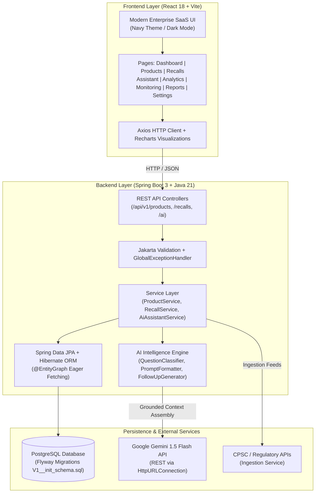
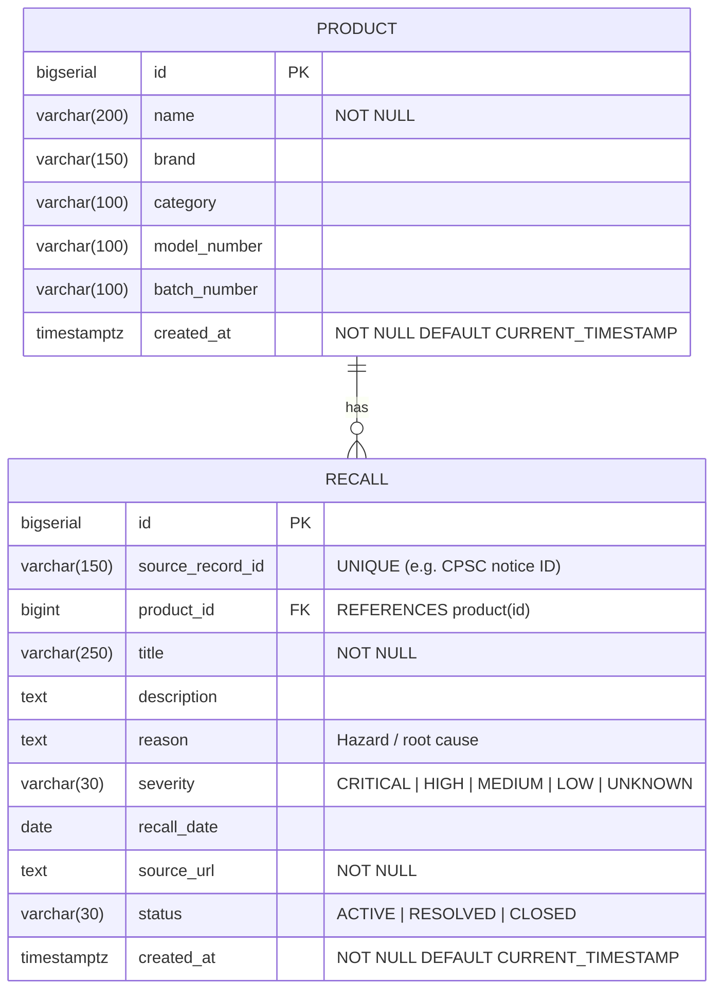

# RecallRadar 🛡️
### AI-Powered Product Recall Intelligence & Risk Analysis Platform

[](https://spring.io/projects/spring-boot)
[](https://www.oracle.com/java/)
[](https://react.dev/)
[](https://www.postgresql.org/)
[](https://vitejs.dev/)
[](https://ai.google.dev/)

**RecallRadar** is an enterprise-grade full-stack product safety intelligence platform. It tracks product catalogue items, monitors regulatory recall notices, evaluates risk severity, provides interactive visual analytics, exports compliance reports, and incorporates an AI assistant powered by Google Gemini with strict grounding against verified database records.

---

## 1. System Architecture



---

## 2. Entity-Relationship Diagram (ERD)



---

## 3. Core Features & Capabilities

### 🛍️ 1. Product Catalogue Management
- Complete CRUD operations: Add, Inspect, Update, and Delete registered products.
- Tracks manufacturer brand, industry category, model identifier, and batch/lot codes.
- High-performance client search and server pagination.

### ⚠️ 2. Complete Recall Notice Register
- Tracks recall title, hazard causes, detailed remedies, official notice URLs, and status (`ACTIVE`, `RESOLVED`, `CLOSED`).
- **Normalized Severity Tiering**: Truthful categorization into **CRITICAL** (Red), **HIGH** (Orange), **MEDIUM** (Yellow/Amber), **LOW** (Green), and **UNKNOWN** (Neutral Grey).
- Dynamic product association: seamlessly resolves nested product entities, DTO flat identifiers, or cross-referenced IDs, with a clear fallback ("Product not linked") for unassociated notices.
- Comprehensive date range filters (`fromDate` to `toDate`), text search, and pagination controls.

### 👁️ 3. Active Recall Surveillance Watchlist
- Dedicated monitoring page highlighting actively enforced notices that require operational follow-up.
- Metric cards showing active notices, critical alerts, high-risk items, and total distinct affected products.
- Detailed modal view displaying full product metadata, root-cause hazard summaries, and regulatory notice links.

### 🤖 4. AI-Powered Recall Assistant
- Natural language safety queries grounded on the live PostgreSQL database.
- Multi-intent classification: detects greetings, general safety queries, specific model/batch lookups, and recall ID lookups.
- Conversational follow-ups: generates dynamic 1-click suggested prompts and retains conversation context.
- **Anti-Hallucination Guardrails**: Strictly constrained to verify identifiers against the database and refuses to invent simulated recall IDs or certify non-existent safety approvals.

### 📊 5. Risk Analytics & Data Insights
- Normalized recall severity distribution (Recharts PieChart with tooltips and legend, omitting zero-count tiers).
- Recalls by product category bar chart for sector-wide risk concentration analysis.
- Monthly timeline trend chart tracking notice volumes over time.
- Executive risk summary providing auto-generated compliance takeaways.

### 📥 6. Reports & Data Export Center
- One-click exports in **CSV** (with UTF-8 BOM encoding for Excel compatibility) and **JSON** formats.
- Five distinct report packages: Product Catalogue, Complete Recall Register, Priority Alerts (Critical & High), Active Enforcement Watchlist, and Executive Risk Summary.
- In-browser modal table preview displaying the top records before download.

### ⚙️ 7. System Settings & Diagnostics
- Dark / Light theme switch with persistence.
- Live backend connectivity health checker with real-time round-trip latency measurement (ms).
- Live AI service diagnostic indicator.

---

## 4. REST API Endpoint Reference

| Method | Endpoint | Description | Request Body / Parameters | Status Codes |
|---|---|---|---|---|
| `POST` | `/api/v1/auth/login` | User authentication & JWT generation | `LoginRequest` (username, password) | `200 OK`, `401 Unauthorized` |
| `POST` | `/api/v1/auth/register` | Register new user account | `RegisterRequest` (username, email, password, role, fullName) | `201 Created`, `409 Conflict` |
| `GET` | `/api/v1/auth/me` | Current authenticated user info | Bearer JWT Header | `200 OK`, `401 Unauthorized` |
| `GET` | `/api/v1/products` | Paginated product list | `page=0&size=10` | `200 OK` |
| `GET` | `/api/v1/products/{id}` | Product details by ID | Path variable `id` | `200 OK`, `404 Not Found` |
| `POST` | `/api/v1/products` | Register a new product (ADMIN) | `ProductRequest` (name, brand, category, modelNumber, batchNumber) | `201 Created`, `400 Bad Request` |
| `PUT` | `/api/v1/products/{id}` | Update product details (ADMIN) | `ProductRequest` | `200 OK`, `404 Not Found` |
| `DELETE` | `/api/v1/products/{id}` | Delete product (ADMIN) | Path variable `id` | `204 No Content`, `404 Not Found` |
| `GET` | `/api/v1/recalls` | Paginated recall notices | `page=0&size=10` | `200 OK` |
| `GET` | `/api/v1/recalls/{id}` | Recall notice details | Path variable `id` | `200 OK`, `404 Not Found` |
| `GET` | `/api/v1/recalls/search` | Search & filter recalls | `keyword`, `severity`, `status`, `page`, `size` | `200 OK` |
| `POST` | `/api/v1/recalls` | Register a new recall (ADMIN, ANALYST) | `RecallRequest` (title, severity, sourceUrl, etc.) | `201 Created`, `400 Bad Request`, `409 Conflict` |
| `PUT` | `/api/v1/recalls/{id}` | Update recall notice (ADMIN, ANALYST) | `RecallRequest` | `200 OK`, `404 Not Found` |
| `PATCH` | `/api/v1/recalls/{id}/severity` | Re-evaluate severity with audit trail | `UpdateSeverityRequest` (severity, reason, changedBy) | `200 OK`, `400 Bad Request` |
| `GET` | `/api/v1/recalls/{id}/severity-audit` | Audit log of severity changes | Path variable `id` | `200 OK`, `404 Not Found` |
| `GET` | `/api/v1/recalls/{id}/candidate-matches` | Match candidates with confidence % | Path variable `id` | `200 OK`, `404 Not Found` |
| `POST` | `/api/v1/recalls/{id}/associate` | Link or unlink product to recall | `AssociateProductRequest` (productId, status, notes) | `200 OK`, `400 Bad Request` |
| `DELETE` | `/api/v1/recalls/{id}` | Delete recall notice (ADMIN) | Path variable `id` | `204 No Content`, `404 Not Found` |
| `GET` | `/api/v1/analytics/summary` | Real-time system risk & catalogue metrics | — | `200 OK` |
| `GET` | `/api/v1/ai/analytics/trends` | AI trends aggregation & narrative | `ai=true/false` | `200 OK` |
| `GET` | `/api/v1/ai/analytics/hazards` | Hazard cluster analytics | `ai=true/false` | `200 OK` |
| `GET` | `/api/v1/ai/analytics/brand` | Brand safety profile & risk assessment | `brand=Samsung&ai=true` | `200 OK` |
| `POST` | `/api/v1/ai/assistant` | Query grounded AI assistant | `AssistantRequest` (question, conversationHistory) | `200 OK`, `400 Bad Request` |
| `GET` | `/api/v1/ai/health` | AI health & latency diagnostics | — | `200 OK` |

---

## 5. Getting Started & Setup

### Prerequisites
- Java Development Kit (JDK 21+)
- Node.js (v18+) & npm
- PostgreSQL (v14+)
- Maven (v3.9+)

### 1. Database Setup
Create a PostgreSQL database named `recallradar`:
```sql
CREATE DATABASE recallradar;
```
Flyway automatically applies all schema migrations (`V1__init_schema.sql`, `V2__severity_audit_and_association_status.sql`, `V3__user_and_auth_tables.sql`) on backend startup.

#### 👥 Seeded Demonstration Accounts
| Role | Username | Password | Permissions |
|---|---|---|---|
| **Administrator** | `admin` | `Admin@123!` | Full CRUD on Products & Recalls, Severity Review, Candidate Matching |
| **Risk Analyst** | `analyst` | `Analyst@123!` | Recall Creation/Update, Severity Reviews, Product Candidate Linking |
| **Standard Viewer** | `viewer` | `Viewer@123!` | Read-only Catalogue Access, AI Assistant, Risk Analytics, Export Reports |

### 2. Backend Configuration
Navigate to `recallradar-backend/recallradar-backend` and configure your `.env` or `application.properties`:
```properties
server.port=8080
spring.datasource.url=jdbc:postgresql://localhost:5432/recallradar
spring.datasource.username=postgres
spring.datasource.password=postgres
spring.jpa.hibernate.ddl-auto=validate
spring.flyway.enabled=true
gemini.api-key=YOUR_GEMINI_API_KEY
gemini.model=gemini-2.5-flash
```

Run the backend application:
```bash
# Using Maven wrapper or local Maven
mvn clean spring-boot:run
```
Flyway will automatically execute `V1__init_schema.sql` on startup to initialize the schema and indexes.

### 3. Frontend Setup
Navigate to `recallradar-frontend`:
```bash
npm install
npm run dev
```
The application will launch at `http://localhost:5173`.

---

## 6. Placement & Technical Interview Guide

### 🎙️ The 30-Second Elevator Pitch
> *"RecallRadar is an AI-powered product safety and recall intelligence platform. Built with Java 21, Spring Boot, React, and PostgreSQL, it bridges regulatory compliance with actionable enterprise risk analytics. Users can catalog products, track recall notices, analyze severity distributions with interactive charts, and query an AI safety assistant powered by Google Gemini that is grounded against our PostgreSQL database to prevent hallucinations."*

### 🏛️ The 3-Minute Architectural Deep-Dive
1. **Frontend Architecture:**
   - Single Page Application built on React 18 and Vite.
   - Reusable component hierarchy: `DataTable` with horizontal scroll isolation, semantic `Severity` badges, `StatCard`, and modal workflows.
   - Dynamic cross-referencing: when backend records lack direct product associations, the frontend cross-references product catalogue items or falls back to clear indicators ("Product not linked") without UI degradation.
2. **Backend Architecture:**
   - Layered architecture following clean code principles: Controller -> Service -> Repository -> Database.
   - DTO pattern with Java 21 `record` types (`ProductRequest`, `ProductResponse`, `RecallRequest`, `RecallResponse`) guaranteeing immutability.
   - `@EntityGraph` and custom JPQL queries with `LEFT JOIN FETCH` to eliminate Hibernate N+1 query overhead and prevent `LazyInitializationException`.
   - Global exception handling using `@RestControllerAdvice` to translate domain exceptions into standard HTTP error responses.
3. **AI Grounding & Prompt Engineering:**
   - Instead of passing unconstrained questions to an LLM, the backend uses a multi-tier pipeline:
     1. `QuestionClassifier` categorizes user intent (greetings, general safety, database stats, or specific recall lookups).
     2. Exact regex extraction searches for model numbers, batch numbers, or recall IDs.
     3. A prioritized SQL search retrieves candidate records.
     4. Grounded context is formatted and submitted to Google Gemini with negative constraints ("If zero records found, state so; never invent safety notices").
     5. `FollowUpGenerator` creates dynamic suggested follow-ups for user exploration.

---

### ❓ Key Technical Q&A for Placement Evaluators

**Q1: How did you solve the N+1 problem in Spring Data JPA?**
> *Answer:* In `RecallRepository`, we applied `@EntityGraph(attributePaths = "product")` to search queries and `LEFT JOIN FETCH r.product` to `findByIdWithProduct`. This instructs Hibernate to fetch both the `Recall` and associated `Product` entity in a single SQL query, avoiding subsequent `SELECT` calls for every recall record.

**Q2: How do you prevent AI hallucinations in product safety queries?**
> *Answer:* We employ a Retrieval-Augmented Generation (RAG) pattern. Before invoking Gemini, our backend queries the PostgreSQL database for matching product models, batch numbers, or recall IDs. The assembled database records are injected into a system prompt with strict constraints: if no matching records exist, the model is instructed to explicitly state that zero records exist rather than hallucinating safety certifications.

**Q3: How is database evolution managed in production?**
> *Answer:* We utilize Flyway database migrations (`V1__init_schema.sql`). `spring.jpa.hibernate.ddl-auto` is set to `validate`, ensuring Hibernate validates that entities match the Flyway-managed schema without altering tables at runtime.

**Q4: How did you handle horizontal table overflow on mobile and tablet screens?**
> *Answer:* In `DataTable.jsx` and `style.css`, we encapsulated the table in a `.table-wrap` container with an internal `.scroll` wrapper using `-webkit-overflow-scrolling: touch` and `overflow-x: auto`. We constrained `html` and `body` to `max-width: 100vw; overflow-x: hidden`, ensuring table scrollbars remain localized within the panel card and never cause page-level horizontal overflow.
